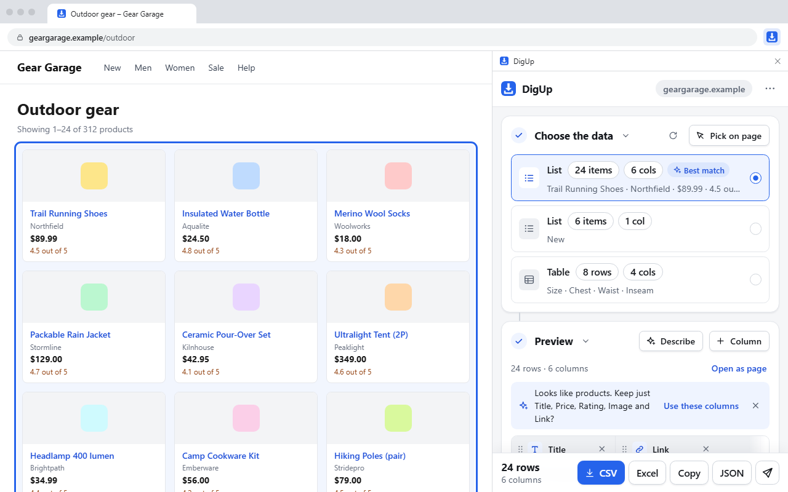
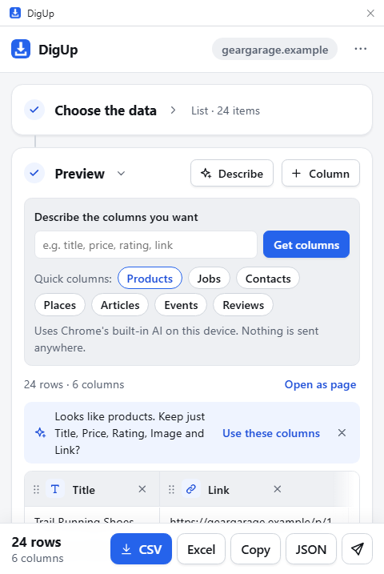
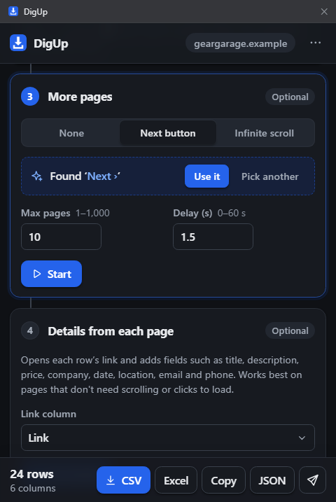
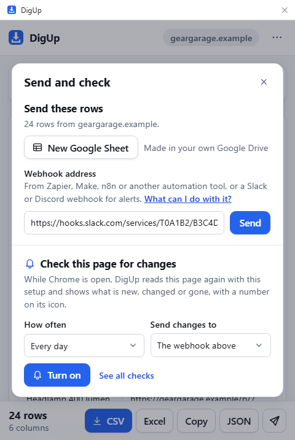
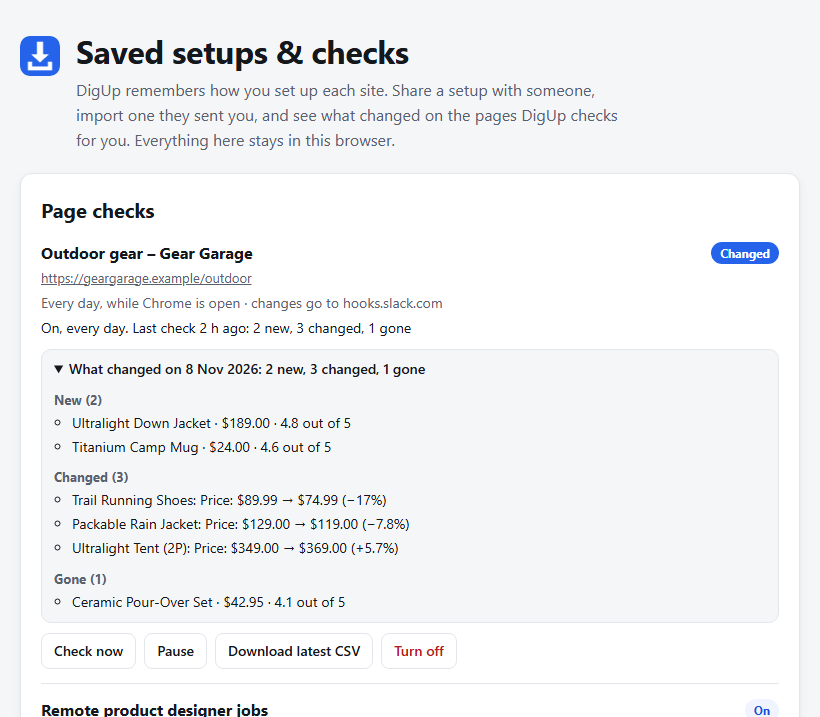

  

<h1 align="center">DigUp</h1>

  <strong>Turn any web page into a clean spreadsheet, in one click.</strong> 
  A free, point-and-click web scraper for Chrome. No account, no limits, and nothing leaves your browser.

  <a href="https://chromewebstore.google.com/detail/hbojoclhnohajcagdelbelbelhkahbjj?utm_source=github&amp;utm_medium=readme"><strong>➕ Add DigUp to Chrome, it's free</strong></a>
  &nbsp;·&nbsp;
  <a href="https://satyasampathirao.github.io/DigUp/">Website</a>
  &nbsp;·&nbsp;
  <a href="https://youtu.be/x_RWr90C6h0">32-second demo</a>
  &nbsp;·&nbsp;
  <a href="https://satyasampathirao.github.io/DigUp/privacy.html">Privacy</a>

   
  Click the picture to watch the 32-second demo on YouTube.

---

## What DigUp does

DigUp finds the tables and lists on a web page, gives the columns clear names, and exports every row to **CSV, Excel, JSON or Google Sheets**. It follows the Next button for more pages, adds details from each item's own page, and can check a page for changes every day.

- ✅ **Free:** no account, no subscription, no credits, no row limits
- 🔒 **Private:** pages are read on your computer; rows go only where you send them
- 🎯 **Exact:** every row is copied as the page shows it, nothing guessed or rewritten
- ⚡ **Fast:** thousands of rows in seconds, up to 50 pages in one run
- 🔁 **Repeatable:** DigUp remembers your setup for each website

## How it works: three steps, a few seconds

### 1. Open DigUp on any page
Click the DigUp icon in Chrome's toolbar, or press **Alt+Shift+D**. DigUp scans the page, finds every table and list, and picks the best one for you. Not the right one? Press **Pick on page** and click any item in the list you want.

### 2. Get the columns you need
Columns get clear names such as Title, Price, Rating, Email and Link. Then shape them your way:
- **Quick columns:** when a list looks like products, jobs, contacts, places, articles, events or reviews, DigUp offers that kind's usual columns in one click.
- **Describe columns:** type what you want in plain words, like `title, price without currency, link`, and DigUp picks the matching fields in that order.
- **Do it yourself:** rename, reorder, delete or add columns.

  

### 3. Export or send
Download **CSV**, **Excel (.xlsx)** or **JSON**, copy the rows straight into Google Sheets or Excel, make a **new Google Sheet** in your own Drive, or send the rows to your own apps through a **webhook**.

## Features

### 📄 Every page, not just the first
DigUp finds the page's **Next** button for you, or scrolls lists that load as you go (infinite scroll). You set a page limit and a delay between pages, and you can stop at any time.

  

### 🔎 Details from each item's page
A list often shows only a title and a price. **Details from each page** opens every item's own page and adds fields such as description, company, date, location, email and phone, as new columns. It only visits the site you are scraping.

### 📤 Send rows where you work
- **New Google Sheet:** one click makes a sheet in your own Google Drive. DigUp uses Google's narrow permission, so it can see only the sheets it creates.
- **Webhook:** post the rows as JSON to your automation tool or CRM, or as a short readable message to Slack or Discord. See the [webhook guide](https://satyasampathirao.github.io/DigUp/webhooks.html).

  

### 🔔 Know when a page changes
Turn on a check and DigUp reads the page again every 12 hours, every day or every week while Chrome is open. You see what is **new, changed or gone**, with price drops first, for example *Trail Running Shoes: Price: $89.99 → $74.99 (−17%)*. A number on DigUp's icon tells you there is something new, and changes can also go to a Google Sheet, a webhook or your team chat.

  

### ✨ AI columns, on your device
Where Chrome's built-in AI is already on your computer, DigUp can add columns such as **summary**, **category** or **sentiment** for every row. The AI runs on your device; nothing is sent to an AI service.

### 🤖 A scraping tool for AI agents
AI apps such as Claude, Cursor and other MCP apps can use DigUp to list your open pages, find the lists on a page and scrape it, in your own Chrome. It is off until you turn it on. See the [AI agents guide](https://satyasampathirao.github.io/DigUp/ai-agents.html).

### 💾 Saved setups you can share
DigUp remembers your list, columns and Next button for each website, so next time it is one click. **Share** a setup as text or a file, and **Import** one someone sent you.

### 🧹 Clean data before you export
Duplicate rows and mostly empty columns are each removed in one click. Ratings such as `4.8 (979)` are split into a rating and a review count, and Email, Phone and Social columns are found for you.

## Great for

| Use case | What you get |
|---|---|
| **Lead lists** | Names, companies, emails and phone numbers from directories and member pages |
| **Price tracking** | Shop pages checked every day, with price drops first |
| **Job research** | Titles, companies, locations and salaries, with new postings flagged |
| **Listings and reviews** | Properties, events, ratings and search results in one sheet |
| **Research and journalism** | Tables and lists from public sources, exact and repeatable |
| **AI agents** | Your AI app asks, DigUp scrapes in your own Chrome |

## Why DigUp

| | **DigUp** | Typical AI scraper extension |
|---|---|---|
| Price | Free, no limits | Monthly credits, paid plans |
| Account | None | Sign-up required |
| Your data | Stays in your browser | Pages sent to their servers |
| Results | Every row, exactly as shown | AI may skip rows or change values |
| Next time | Same columns in one click | Each run is interpreted again |

## Get started in a minute

1. Open DigUp in the [Chrome Web Store](https://chromewebstore.google.com/detail/hbojoclhnohajcagdelbelbelhkahbjj?utm_source=github&amp;utm_medium=readme) and click **Add to Chrome**.
2. Pin DigUp to the toolbar: click the puzzle-piece icon, then the pin next to DigUp.
3. Open a page with a table or a list, such as search results, a product category or a directory.
4. Click the DigUp icon (or press **Alt+Shift+D**). The side panel opens with the rows ready.
5. Choose your columns and click **CSV**, **Excel**, **Copy** or **JSON**.

**Tip:** DigUp asks for access to a website only when it needs it, for example to follow a Next button that loads a new page. You can also turn on "Allow DigUp on all sites" in DigUp's menu.

## Questions

**Is DigUp really free?**
Yes. No account, no credits and no row limits. Everything runs on your computer, so there are no servers to pay for.

**Does DigUp send my data anywhere?**
No. Pages are read in your browser and nothing is sent to the developer. Rows leave your browser only when you send them to a Google Sheet or a webhook you chose. See the [privacy policy](https://satyasampathirao.github.io/DigUp/privacy.html).

**Which websites does it work on?**
Most pages with a table or a repeating list: shops, directories, job boards, search results and more. Chrome's own pages and the Chrome Web Store are off-limits to all extensions. Please respect each website's terms of use.

**What about CAPTCHAs and sign-in pages?**
DigUp never gets past them. If a page asks you to verify or sign in, do it yourself in the tab and press **Scan again**.

**Do page checks run when Chrome is closed?**
No. Checks run while Chrome is open, and a missed check runs when Chrome starts again. That is the price of keeping everything on your device.

## Feedback and support

- 🐞 Report a problem or ask for a feature: **Report a problem** in DigUp's menu, or the [feedback form](https://forms.gle/Sjkho4VhEgyqbmFx7)
- ✉️ Email: [digup@healthyailabs.com](mailto:digup@healthyailabs.com)
- ⭐ Enjoying DigUp? A [rating in the Chrome Web Store](https://chromewebstore.google.com/detail/hbojoclhnohajcagdelbelbelhkahbjj/reviews?utm_source=github&amp;utm_medium=readme) helps others find it.

## About this repository

This repository hosts DigUp's public pages: the [website](https://satyasampathirao.github.io/DigUp/), the [privacy policy](https://satyasampathirao.github.io/DigUp/privacy.html), the [webhook guide](https://satyasampathirao.github.io/DigUp/webhooks.html) and the [AI agents guide](https://satyasampathirao.github.io/DigUp/ai-agents.html). The extension itself is installed from the Chrome Web Store.

DigUp is free and made by an independent developer. Not affiliated with Google.
